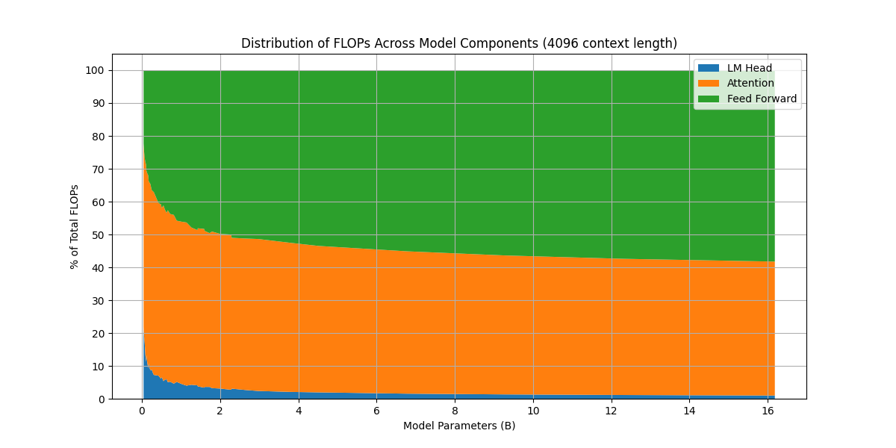
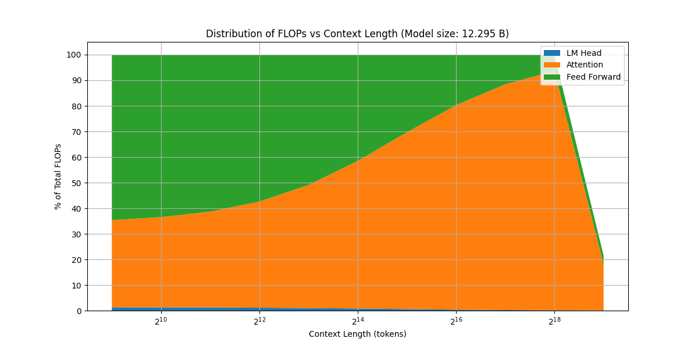

## FLOPs 计算

### 基本规则与假设

对 $A\in\mathbb{R}^{m\times p}$、$B\in\mathbb{R}^{p\times n}$，计算 $AB$ 的主导 FLOPs 为 $2mnp$。额外的 bias 加法只有 $mn$ 次，通常可忽略。下面忽略 normalization、激活函数、residual、mask 和 softmax 的低阶开销，embedding 按查表处理。

算力也可用 PF-days 表示：$1\text{ PF-day}=10^{15}\times24\times3600$ FLOPs。下面先计算单条长度为 $s$ 的序列，再扩展到完整训练集。

### 前向传播

模型包含输入 embedding、$L$ 层 decoder block 和输出 lm head：

$$
F_{\mathrm{forward}}=L(F_{\mathrm{attention}}+F_{\mathrm{FFN}})+F_{\mathrm{lm\_head}}
$$

#### Embedding 与输出 head

输入 embedding 查表不执行矩阵乘法，按本节口径计为 0 FLOPs。输出 head 将 $s\times d$ 的隐藏状态投影到词表：

$$
F_{\mathrm{lm\_head}}=2sd|V|
$$

共享输入与输出 embedding 可以减少参数存储，但不会省掉输出 head 的这次计算。

#### Attention：MHA、GQA 与 MQA

每层 Q、K、V、O 投影的总计算量为

$$
F_{\mathrm{projection}}=4sdhd_h+4sdh_{kv}d_h
$$

其中 Q 和 O 各贡献 $2sdhd_h$，K 和 V 各贡献 $2sdh_{kv}d_h$。对每个 Query head，$QK^T$ 和 attention probability 与 V 相乘各需要 $2s^2d_h$ FLOPs，因此

$$
\boxed{F_{\mathrm{attention}}=4sdd_h(h+h_{kv})+4s^2hd_h}
$$

这里按完整 $s\times s$ attention 矩阵计数；causal kernel 若跳过上三角，attention 核心计算的常数会降低。

- MHA：$h_{kv}=h$。进一步令 $hd_h=d$，得到 $F_{\mathrm{attention}}=8sd^2+4s^2d$。
- GQA：多个 Query head 共享一组 K/V，减少 K/V 投影和 KV cache，attention 核心仍按 $h$ 个 Query head 计算。
- MQA：$h_{kv}=1$。

若用 $g=h/h_{kv}$ 表示每组共享 K/V 的 Query head 数，则 $g=1$ 对应 MHA，$g=h$ 对应 MQA。

#### Dense FFN 与 MoE

两层 ReLU FFN 包含两个矩阵乘法，因此

$$
F_{\mathrm{FFN,ReLU}}=4sdd_{ff}
$$

SwiGLU FFN 使用三个投影：$y=W_2(\mathrm{SiLU}(W_1x)\odot W_3x)$，其中 $\mathrm{SiLU}(z)=z\odot\sigma(z)$，因此

$$
\boxed{F_{\mathrm{FFN,SwiGLU}}=6sdd_{ff}}
$$

对于包含 $E$ 个专家、每个 token 激活 $k$ 个专家的 MoE，router 是一个 $d\times E$ 的线性层。忽略路由选择和通信开销后：

$$
\boxed{F_{\mathrm{MoE}}=2sdE+6ksdd_{ff}}
$$

这里 $d_{ff}$ 为单个专家的中间维度。总专家数影响模型存储，实际参与矩阵乘法的专家数决定主要 FLOPs。更多架构背景见 [MoE](/blog/moe/)。

#### 前向汇总

对 GQA + SwiGLU 的 Dense 模型，

$$
\boxed{F_{\mathrm{forward}}\approx L\left[4sdd_h(h+h_{kv})+4s^2hd_h+6sdd_{ff}\right]+2sd|V|}
$$

若使用标准 MHA 且 $hd_h=d$，则

$$
F_{\mathrm{forward}}\approx Lsd^2\left(8+\frac{4s}{d}+\frac{6d_{ff}}{d}+\frac{2|V|}{Ld}\right)
$$

normalization 的开销为 $\mathcal{O}(sd)$，相对于投影的 $\mathcal{O}(sd^2)$ 是低阶项；这里统一省略，不再混用精确计数与近似计数。

### 反向传播与训练总量

对线性层 $Y=XW$，反向传播需要计算输入梯度与权重梯度：

$$
\frac{\partial\mathcal L}{\partial X}=\frac{\partial\mathcal L}{\partial Y}W^T,
\qquad
\frac{\partial\mathcal L}{\partial W}=X^T\frac{\partial\mathcal L}{\partial Y}
$$

这两次矩阵乘法分别与前向计算同阶，因此矩阵乘法主导、全部参数参与训练时，$F_{\mathrm{backward}}\approx2F_{\mathrm{forward}}$，从而

$$
\boxed{C_{\mathrm{sequence}}\approx3F_{\mathrm{forward}}}
$$

这一估计不包含 optimizer update、通信、activation checkpointing 的重计算或冻结参数带来的变化。

### 从逐层公式到 Scaling Law

在标准 MHA 下取 $d_{ff}=\frac83d$，并忽略 normalization 与 embedding/head 的参数，上一节的公式给出

$$
P\approx L(4d^2+3dd_{ff})=12Ld^2
$$

若 attention 的 $s^2$ 项和输出 head 的开销也相对较小，则

$$
C_{\mathrm{sequence}}\approx3Ls(8d^2+6dd_{ff})=72Lsd^2\approx6sP
$$

训练集总共有 $D$ 个 token 时，得到常用估算：

$$
\boxed{C\approx6PD}
$$

这也就是常写为 $C\approx6ND$ 的公式；本文统一用 $P$ 表示参数量，以免与层数混淆。它适合矩阵投影占主导的 Dense 模型，长上下文、较大的词表或 MoE 应优先使用逐层公式。MoE 可以按激活的矩阵参数估算，但总参数量不能直接代入。

### FLOPs 分布实验

保留原文基于 [Chinchilla scaling law](/blog/scaling-law/#chinchilla) Table A9 的配置分析，筛掉 `kv_size * n_heads != d_model` 的配置，词表大小为 32,000。本实验使用两矩阵 FFN，与前面默认的三矩阵 SwiGLU 区分。计算所有层的代码为：

```python
def compute_flops(L, V, d, d_ff, s, swiglu=False):
    lm_head_flops = 2 * V * d * s
    attention_flops = L * (8 * s * d * d + 4 * s * s * d)
    feed_forward_flops = L * (6 if swiglu else 4) * s * d * d_ff
    return lm_head_flops, attention_flops, feed_forward_flops
```



原文图表展示了模型规模增加时 FFN 计算占比的变化。原示例代码遗漏了层数乘数，上方代码已修正；图表保留供趋势参考，精确比例应以修正后的代码重算。



上下文变长时，attention 的二次项占比增加。原图最右侧的异常下降应视为数值或绘图异常，不能解释为真实计算量下降。
